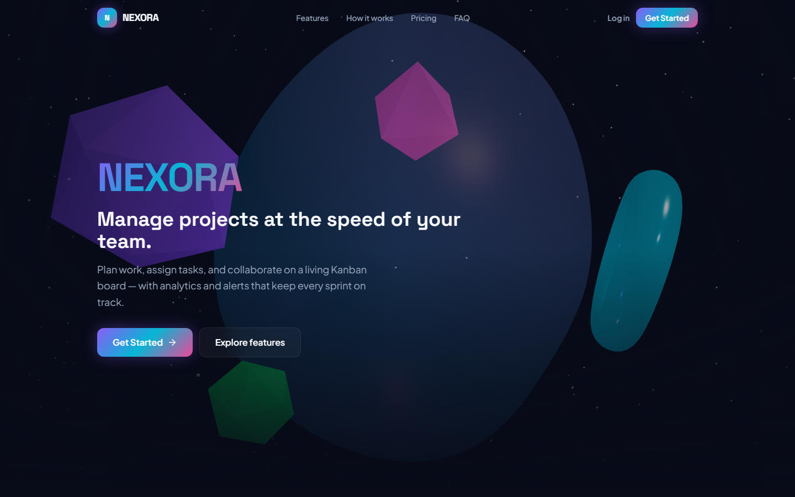
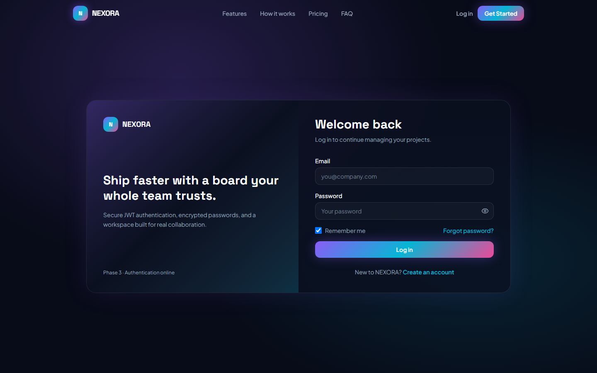
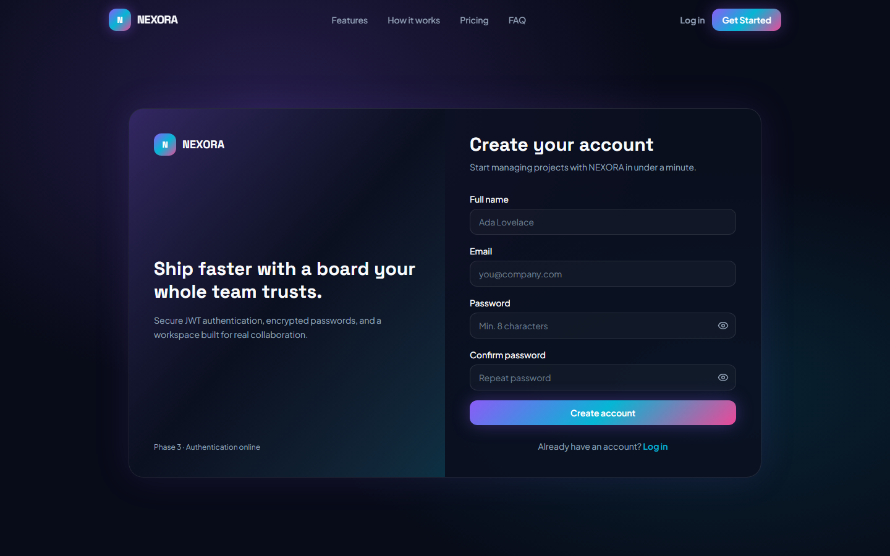

# NEXORA – Smart Project Management Platform

Premium MERN Stack SaaS for project management, Kanban workflows, team collaboration, analytics, and real-time notifications — with a futuristic dark UI and 3D motion.

[](./LICENSE)
[](#technology-stack)
[](#development-phases)

> **Status:** Phase 10 in progress — production configs hardened; live URLs need your Atlas / Render / Vercel accounts.  
> Cutover steps: **[docs/PHASE_10.md](docs/PHASE_10.md)**

---

## Screenshots

<p align="center">
  
</p>

| Landing | Auth |
|---------|------|
|  |  |
| Marketing hero + R3F scene | Secure JWT login |

| Register | Capture more |
|----------|----------------|
|  | Dashboard / Kanban — see [`docs/screenshots`](docs/screenshots) |

---

## Features

- Project & task management with Kanban drag-and-drop (`@dnd-kit`)
- Team invites and role-based permissions
- Task comments and activity history
- Dashboard analytics (Recharts)
- Real-time notifications (Socket.IO)
- JWT authentication (httpOnly cookie + Bearer)
- Profile, settings, theme prefs (dark / light)
- Interactive 3D landing experience (React Three Fiber)
- Mobile bottom navigation + responsive layouts
- Lazy-loaded routes and vendor chunk splitting

---

## Technology stack

| Layer | Stack |
|--------|--------|
| Frontend | React 19, Vite, Tailwind CSS v4, Redux Toolkit, Framer Motion, R3F, dnd-kit, Recharts |
| Backend | Node.js, Express, MongoDB, Mongoose, JWT, Socket.IO, Helmet, CORS, rate limiting |
| Deploy | Vercel (frontend), Render (backend), MongoDB Atlas |

---

## Folder structure

```text
NEXORA/
├── frontend/                 # React + Vite app
│   ├── public/
│   ├── src/
│   │   ├── components/       # ui, layout, 3d, charts, kanban
│   │   ├── context/
│   │   ├── layouts/
│   │   ├── pages/
│   │   ├── routes/
│   │   ├── services/
│   │   └── store/
│   ├── vercel.json           # SPA rewrites for Vercel
│   ├── .env.example
│   └── package.json
├── backend/                  # Express API
│   ├── src/
│   │   ├── config/
│   │   ├── controllers/
│   │   ├── middleware/
│   │   ├── models/
│   │   ├── routes/
│   │   ├── sockets/
│   │   ├── app.js
│   │   └── server.js
│   ├── scripts/smoke-test.js
│   ├── .env.example
│   └── package.json
├── docs/
│   ├── DEPLOYMENT.md         # Atlas / Render / Vercel checklist
│   ├── GITHUB_SETUP.md       # Create & push the GitHub repo
│   └── screenshots/
├── scripts/
│   └── capture-screenshots.mjs
├── render.yaml               # Render Blueprint for the API
├── .gitignore
├── LICENSE
└── package.json
```

---

## Prerequisites

- Node.js 18+ (recommended 20+)
- npm 9+
- MongoDB locally **or** Atlas — or set `USE_MEMORY_MONGO=true` for local demos

---

## Installation

```bash
# From project root
npm run install:all
```

Or separately:

```bash
cd frontend && npm install
cd ../backend && npm install
```

---

## Environment variables

### Frontend (`frontend/.env`)

Copy `frontend/.env.example`:

```env
VITE_API_URL=http://localhost:5000/api
```

### Backend (`backend/.env`)

Copy `backend/.env.example`:

```env
PORT=5000
NODE_ENV=development
MONGODB_URI=mongodb://127.0.0.1:27017/nexora
USE_MEMORY_MONGO=true
JWT_SECRET=change_this_to_a_long_random_secret_in_production
CLIENT_URL=http://localhost:5173
COOKIE_SECURE=false
```

For Atlas, set `USE_MEMORY_MONGO=false` and replace `MONGODB_URI` with your cluster URI.

**Never commit `.env` files.**

---

## Run locally

Terminal 1 — API:

```bash
cd backend
npm run dev
```

Terminal 2 — UI:

```bash
cd frontend
npm run dev
```

- Frontend: http://localhost:5173 (or 5174 if 5173 is busy)  
- API health: http://localhost:5000/api/health  

### Smoke test (API)

With the backend running:

```bash
cd backend
npm run smoke
```

---

## API documentation

| Method | Endpoint | Description |
|--------|----------|-------------|
| GET | `/` | Welcome payload |
| GET | `/api/health` | Health + DB connection state |
| POST | `/api/auth/register` | Create account |
| POST | `/api/auth/login` | Login (JWT + httpOnly cookie) |
| POST | `/api/auth/logout` | Clear auth cookie |
| GET | `/api/auth/me` | Current user (protected) |
| GET | `/api/dashboard` | Analytics snapshot (protected) |
| POST | `/api/dashboard/seed-demo` | Seed sample projects/tasks (protected) |
| GET/POST | `/api/projects` | List / create projects |
| GET/PUT/DELETE | `/api/projects/:id` | Project details / update / delete |
| GET/POST | `/api/projects/:projectId/tasks` | List / create tasks |
| PUT/PATCH/DELETE | `/api/tasks/:id` | Update / move / delete task |
| GET/POST | `/api/projects/:projectId/team` | Team list / invite |
| PATCH/DELETE | `/api/projects/:projectId/team/:userId` | Update role / remove |
| GET/POST | `/api/tasks/:taskId/comments` | List / add comments |
| DELETE | `/api/comments/:id` | Delete comment |
| GET/PATCH | `/api/notifications` | List / mark read |
| GET/PUT | `/api/users/me` | Profile get / update |
| PUT | `/api/users/me/password` | Change password |
| PUT | `/api/users/me/settings` | Theme + notification prefs |
| POST | `/api/users/me/deactivate` | Deactivate account |

---

## GitHub

This workspace is git-ready (`.gitignore`, MIT license, docs).

Full push instructions: **[docs/GITHUB_SETUP.md](docs/GITHUB_SETUP.md)**

Quick path (with [GitHub CLI](https://cli.github.com/)):

```bash
gh auth login
gh repo create nexora --public --source=. --remote=origin --push
```

---

## Deployment preparation

Configs committed for Phase 10:

| File | Purpose |
|------|---------|
| [`render.yaml`](./render.yaml) | Render Blueprint for `nexora-api` |
| [`frontend/vercel.json`](./frontend/vercel.json) | Vite SPA rewrites |
| [`docs/DEPLOYMENT.md`](./docs/DEPLOYMENT.md) | Step-by-step Atlas → Render → Vercel |

| Service | Env highlights |
|---------|----------------|
| Frontend (Vercel) | `VITE_API_URL` |
| Backend (Render) | `MONGODB_URI`, `JWT_SECRET`, `CLIENT_URL`, `COOKIE_SECURE=true`, `NODE_ENV=production` |
| Database | MongoDB Atlas (`USE_MEMORY_MONGO=false`) |

---

## Development phases

1. **Phase 1** — Architecture & setup ✅  
2. **Phase 2** — Landing page + 3D hero ✅  
3. **Phase 3** — Auth (JWT) ✅  
4. **Phase 4** — Dashboard + Redux ✅  
5. **Phase 5** — Projects, tasks, Kanban ✅  
6. **Phase 6** — Team, comments, Socket.IO ✅  
7. **Phase 7** — Profile, settings, security ✅  
8. **Phase 8** — Testing & polish ✅  
9. **Phase 9** — GitHub + README + deploy prep ✅  
10. **Phase 10** — Production deploy (Atlas + Render + Vercel) 🔄  

---

## Future improvements

- File attachments on tasks
- Calendar / Gantt views
- Email digest notifications
- Organization workspaces
- Mobile native companion

---

## License

MIT — see [LICENSE](./LICENSE)
